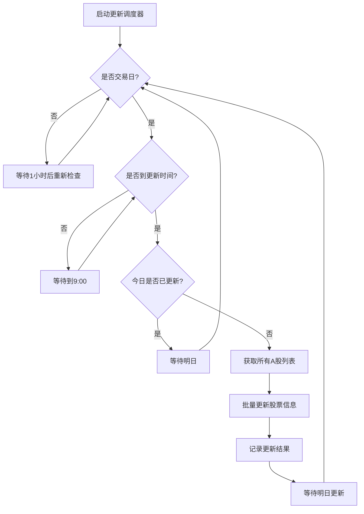

# 股票基础信息表设计与更新方案

## 概述

本文档描述了量化交易系统中股票基础信息表的设计思路、表结构以及每日更新方案。该表专门为A股交易设计，包含了交易决策所需的核心信息。

## 表结构设计

### 设计原则

1. **简洁性**: 只包含A股交易必需的字段，避免冗余信息
2. **实用性**: 字段设计贴合实际交易需求
3. **可维护性**: 结构清晰，便于维护和扩展
4. **性能优化**: 合理的索引设计，提高查询效率

### 表结构

```sql
CREATE TABLE stock_basic_info (
    id INTEGER PRIMARY KEY DEFAULT nextval('stock_basic_info_id_seq'),
    stock_code VARCHAR(20) NOT NULL UNIQUE COMMENT '股票代码，如000001.SZ',
    stock_name VARCHAR(100) NOT NULL COMMENT '股票名称，如平安银行',
    abbreviation VARCHAR(50) COMMENT '股票简称',
    exchange VARCHAR(10) NOT NULL COMMENT '交易所，SZ/SH',
    listing_date VARCHAR(20) COMMENT '上市日期，YYYY-MM-DD格式',
    is_st BOOLEAN DEFAULT FALSE COMMENT '是否为ST股票',
    is_trading BOOLEAN DEFAULT TRUE COMMENT '是否可交易',
    price_tick DOUBLE DEFAULT 0.01 COMMENT '最小价格变动单位，A股通常为0.01',
    created_at TIMESTAMP DEFAULT CURRENT_TIMESTAMP COMMENT '记录创建时间',
    updated_at TIMESTAMP DEFAULT CURRENT_TIMESTAMP COMMENT '记录更新时间'
);
```

### 字段说明

| 字段名 | 类型 | 说明 | 用途 |
|--------|------|------|------|
| id | INTEGER | 主键ID | 数据库内部标识 |
| stock_code | VARCHAR(20) | 股票代码 | 唯一标识股票，如"000001.SZ" |
| stock_name | VARCHAR(100) | 股票名称 | 用于ST股票判断、显示等 |
| exchange | VARCHAR(10) | 交易所 | 区分沪深市场，"SZ"/"SH" |
| listing_date | VARCHAR(20) | 上市日期 | 用于新股判断、历史分析 |
| is_st | BOOLEAN | ST股票标识 | 风控策略中排除ST股票 |
| is_trading | BOOLEAN | 交易状态 | 判断股票是否可交易 |
| price_tick | DOUBLE | 最小价格变动 | 价格计算、订单价格设置 |
| created_at | TIMESTAMP | 创建时间 | 数据追踪 |
| updated_at | TIMESTAMP | 更新时间 | 数据同步状态跟踪 |

### 索引设计

```sql
-- 主要查询索引
CREATE INDEX idx_stock_basic_info_stock_code ON stock_basic_info(stock_code);
CREATE INDEX idx_stock_basic_info_exchange ON stock_basic_info(exchange);
CREATE INDEX idx_stock_basic_info_stock_name ON stock_basic_info(stock_name);

-- 业务逻辑索引
CREATE INDEX idx_stock_basic_info_is_st ON stock_basic_info(is_st);
CREATE INDEX idx_stock_basic_info_is_trading ON stock_basic_info(is_trading);

-- 维护索引
CREATE INDEX idx_stock_basic_info_updated_at ON stock_basic_info(updated_at);
```

## 数据获取与处理

### 数据源

- **主要数据源**: xtquant的`get_instrument_detail()`函数
- **数据内容**: 股票名称、交易状态、价格变动单位等

### 数据处理逻辑

```python
# 从xtquant获取原始数据
instrument_detail = xtdata.get_instrument_detail(stock_code)

# 提取A股相关信息
stock_name = instrument_detail.get('InstrumentName', '')
exchange = 'SZ' if '.SZ' in stock_code else 'SH' if '.SH' in stock_code else ''

# ST股票判断
is_st = any(keyword in stock_name.upper() for keyword in ['ST', '*ST', 'S*ST', 'SST'])

# 构造标准化数据
stock_info = {
    'stock_code': stock_code,
    'stock_name': stock_name,
    'exchange': exchange,
    'listing_date': instrument_detail.get('OpenDate', ''),
    'is_st': is_st,
    'is_trading': instrument_detail.get('IsTrading', True),
    'price_tick': instrument_detail.get('PriceTick', 0.01)
}
```

## 每日更新方案

### 更新策略

1. **更新时机**: 每个交易日上午9:00执行
2. **更新范围**: 所有A股股票（沪深两市）
3. **更新方式**: 增量更新，新增股票插入，现有股票更新
4. **容错机制**: 单只股票失败不影响整体更新

### 更新流程



### 核心组件

#### 1. StockInfoUpdater类

```python
class StockInfoUpdater:
    """股票基础信息更新器"""
    
    async def start_daily_update_scheduler(self):
        """启动每日更新调度器"""
        
    async def update_all_stock_basic_info(self):
        """更新所有股票基础信息"""
        
    async def manual_update_stock_info(self, stock_codes):
        """手动更新指定股票信息"""
```

#### 2. A股股票筛选

```python
def _is_a_share_stock(self, stock_code: str) -> bool:
    """判断是否为A股股票"""
    if stock_code.endswith('.SZ'):
        # 深圳A股：000xxx, 001xxx, 002xxx, 003xxx, 300xxx
        code_num = stock_code[:6]
        return (code_num.startswith('000') or 
               code_num.startswith('001') or 
               code_num.startswith('002') or 
               code_num.startswith('003') or 
               code_num.startswith('300'))
    elif stock_code.endswith('.SH'):
        # 上海A股：600xxx, 601xxx, 603xxx, 605xxx, 688xxx
        code_num = stock_code[:6]
        return (code_num.startswith('600') or 
               code_num.startswith('601') or 
               code_num.startswith('603') or 
               code_num.startswith('605') or 
               code_num.startswith('688'))
    return False
```

### 更新监控

#### 1. 更新状态跟踪

- 最后更新时间
- 总股票数量
- ST股票数量
- 可交易股票数量
- 调度器运行状态

#### 2. 更新日志

```python
async def _log_update_result(self, result: Dict[str, Any]):
    """记录更新结果到数据库"""
    # 记录到notification_log表
    message = f"股票基础信息更新完成: 总数{result['total_count']}, 成功{result['success_count']}, 失败{result['failed_count']}, 耗时{result['duration']:.2f}秒"
```

## 使用示例

### 1. 启动每日更新

```python
from services.stock_info_updater import stock_info_updater

# 启动每日更新调度器
await stock_info_updater.start_daily_update_scheduler()
```

### 2. 手动更新

```python
# 更新指定股票
test_stocks = ['000001.SZ', '000002.SZ', '600000.SH']
result = await stock_info_updater.manual_update_stock_info(test_stocks)

# 更新所有股票
result = await stock_info_updater.update_all_stock_basic_info()
```

### 3. 获取更新状态

```python
status = await stock_info_updater.get_update_status()
print(f"最后更新: {status['last_update']}")
print(f"总股票数: {status['total_count']}")
print(f"ST股票数: {status['st_count']}")
```

### 4. 在策略中使用

```python
from services.xtquant_service import XtQuantService

xtquant_service = XtQuantService()

# 获取股票基础信息
stock_info = await xtquant_service.get_stock_basic_info('000001.SZ')

# 判断是否为ST股票
if stock_info and stock_info.get('is_st'):
    print("这是ST股票，跳过交易")
    
# 检查是否可交易
if stock_info and not stock_info.get('is_trading'):
    print("股票暂停交易")
```

## 性能考虑

### 1. 批量更新优化

- 使用异步批量处理
- 添加请求间隔避免频率限制
- 失败重试机制

### 2. 数据库优化

- 合理的索引设计
- 批量插入/更新
- 连接池管理

### 3. 缓存策略

- 内存缓存热点数据
- 避免重复查询
- 定期刷新缓存

## 维护说明

### 1. 日常维护

- 监控更新日志
- 检查数据完整性
- 处理异常股票

### 2. 数据校验

```python
# 检查数据完整性
SELECT COUNT(*) FROM stock_basic_info WHERE stock_name IS NULL OR stock_name = '';

# 检查ST股票标识
SELECT stock_code, stock_name, is_st 
FROM stock_basic_info 
WHERE (stock_name LIKE '%ST%' AND is_st = false) 
   OR (stock_name NOT LIKE '%ST%' AND is_st = true);
```

### 3. 故障处理

- 网络异常: 自动重试机制
- 数据源异常: 降级处理
- 数据库异常: 事务回滚

## 扩展计划

### 1. 短期扩展

- 增加行业分类字段
- 添加市值信息
- 支持港股、美股

### 2. 长期规划

- 历史变更记录
- 数据质量监控
- 自动化数据修复

## 总结

股票基础信息表的设计遵循了简洁、实用的原则，专门针对A股交易场景进行了优化。通过每日自动更新机制，确保了数据的时效性和准确性。该设计为量化交易系统提供了可靠的基础数据支撑，特别是在ST股票识别、交易状态判断等关键业务场景中发挥重要作用。